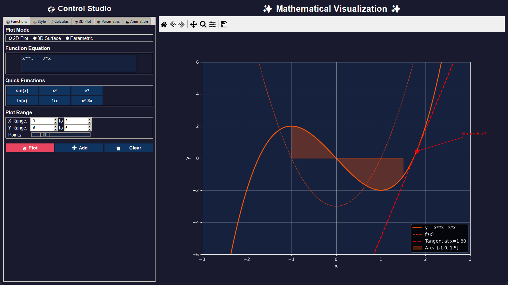
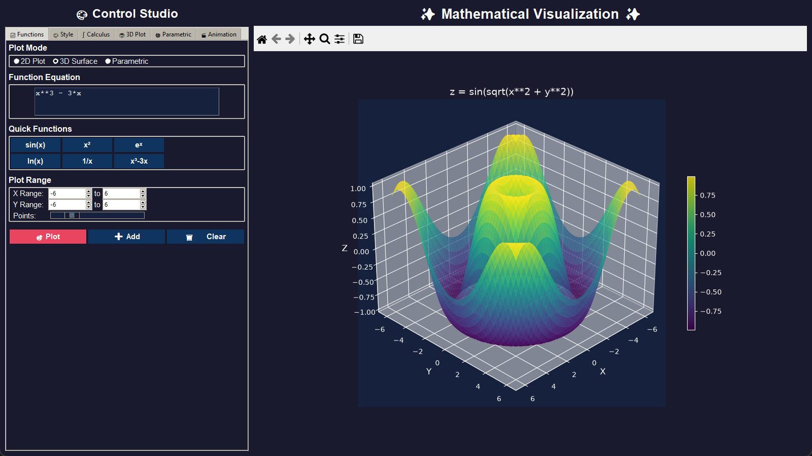
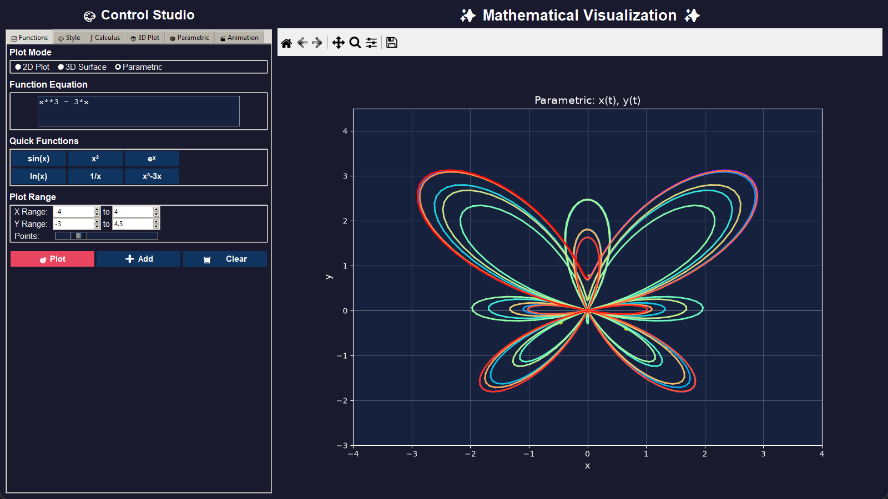

<h1 align="center">Mathematics Visualiser</h1>

<p align="center"><b>A free desktop app for seeing maths move, made by George Politis.</b><br>
Type a function, press Plot. Derivatives, tangents, integrals, 3D surfaces, parametric curves and animations.<br>
Windows · macOS · Linux</p>

<p align="center">
  <a href="https://github.com/georgepol1023/Mathematics-Visualiser/releases/latest"><b>⬇ Download for Windows</b></a> &nbsp;·&nbsp;
  <a href="#install"><b>Install on macOS / Linux</b></a> &nbsp;·&nbsp;
  <a href="LICENSE">MIT licence: free for everyone</a>
</p>

<p align="center">
  <a href="https://github.com/georgepol1023/Mathematics-Visualiser/actions/workflows/tests.yml"></a>
</p>



---

## Install

| Your computer | How | Then |
|---|---|---|
| **Windows** 10 / 11 | [**MathematicsVisualiser.exe**](https://github.com/georgepol1023/Mathematics-Visualiser/releases/latest/download/MathematicsVisualiser.exe) | Double-click it. No installer and no Python needed. |
| **macOS, Linux** (or Windows with Python) | `pipx install git+https://github.com/georgepol1023/Mathematics-Visualiser.git` | Run `mathviz`. Needs Python 3.10 or later ([pipx](https://pipx.pypa.io) keeps it in its own environment; plain `pip install` works too). |

<details>
<summary><b>The first time you open the .exe, Windows shows a warning</b></summary>

The app is free and isn't signed with a paid developer certificate, so Windows asks you to confirm once:
"Windows protected your PC": click **More info**, then **Run anyway**. Each release lists the file's SHA-256 checksum in `SHA256SUMS.txt` if you want to check the download.
</details>

<details>
<summary><b>Linux: "No module named tkinter"</b></summary>

Some distributions ship Tk separately: `sudo apt install python3-tk` (Debian/Ubuntu) or `sudo dnf install python3-tkinter` (Fedora).
</details>

---

## Getting started

1. Type a function of `x` in **Function Equation**, for example `x**3 - 3*x`, or click one of the **Quick Functions**.
2. Set the **X** and **Y range** and press **Plot**. **Add** draws another function on the same axes; **Clear** starts again.
3. Open the **∫ Calculus** tab and tick **Show Derivative**, **Show Integral**, **Show Tangent Line** or **Show Area Under Curve**, then press Plot again. Drag the tangent slider to move the tangent point.
4. Set integration bounds and press **Calculate Area** to get the definite integral, worked out exactly by SymPy and numerically by SciPy, side by side.
5. Click anywhere on the plot to pin its coordinates. The toolbar above the plot pans, zooms and saves.

Write functions the way Python does: `x**2` for x², `2*x` (not `2x`), `sqrt(x)`, `abs(x)`, `exp(x)`, `log(x)` for ln x, `log(x, 10)`, `sin`, `cos`, `tan`, `asin`, `sinh` … and the constants `pi` and `E`.

## What it can do

- **2D plots** of any function of `x`, drawn as a line, scatter, stem, step or bar chart, with as many functions overlaid as you like.
- **Calculus:** the derivative f′(x), the running integral ∫f dx from the lower bound, a tangent line with its slope at any point, the shaded area between two bounds, and the definite integral both exactly and numerically. If SymPy can't find an exact answer within 3 seconds, the app says so and shows the numerical one, so the window never freezes.
- **3D surfaces** `z = f(x, y)` as a surface, wireframe or contour plot, with elevation and azimuth sliders. Presets: ripple, saddle, bowl, wave, peaks and spiral.
- **Parametric curves** `x(t), y(t)` drawn with a colour gradient and direction arrows. Presets: circle, Lissajous figure, rose, spiral, heart and Fay's butterfly curve.
- **Animations** of your own function: phase shift f(x − φ), changing amplitude A·f(x), changing frequency f(kx), the curve drawing itself, and a rotating 3D surface. Save any animation as a GIF.
- **Export** the plot as PNG, PDF or SVG, and the data as CSV.
- **Style:** eight colour schemes, line width, marker size, grid and minor grid, and a light or dark background.

| 3D surface | Parametric curve |
|---|---|
|  |  |

## Is it correct?

The app is covered by 43 automated tests in [`tests/`](tests), run on Windows, macOS and Linux for every change:

- results checked against known answers: derivatives, running integrals and definite integrals such as ∫₀³ x² dx = 9, ∫₀^π sin x dx = 2 and ∫₋₂² e^(−x²) dx = √π·erf(2);
- the real window opened and driven through every plot mode, plot style, 3D style, animation and export;
- awkward input: constants, functions undefined over part of the range (`log(x)`, `1/x`), typing mistakes, and integrals with no closed form.

To run them: `pip install -e ".[dev]"`, then `pytest`.

Derivatives on the plot are numerical (finite differences over the plotted points), so they are slightly less accurate at the two ends of the range and across discontinuities such as `1/x` at 0. The tangent slope and the exact integral come from SymPy.

## Safety and privacy

The app never connects to the internet and collects no data. Equations are read by SymPy's `sympify`, which evaluates its input as Python, so only type or paste expressions you understand, the same as you would in a Python prompt.

## Building it yourself

You need Python 3.10 or later.

```bash
git clone https://github.com/georgepol1023/Mathematics-Visualiser.git && cd Mathematics-Visualiser
pip install -e ".[dev]"      # the app, plus pytest and PyInstaller
python -m mathviz            # run it
pytest                       # run the tests
python build_exe.py          # build dist/MathematicsVisualiser.exe (or the macOS/Linux equivalent)
```

Releases are built by GitHub Actions: pushing a tag such as `v1.0.1` tests the app, builds the Windows `.exe` and attaches it to a new release.

| File | What's in it |
|---|---|
| [`mathviz/app.py`](mathviz/app.py) | the window, the plotting and the animations (Tkinter + Matplotlib) |
| [`mathviz/symbolic.py`](mathviz/symbolic.py) | exact integration in a separate process with a time limit |
| [`tests/test_app.py`](tests/test_app.py) | the test suite |
| [`build_exe.py`](build_exe.py) | the PyInstaller build |

## Licence

Mathematics Visualiser is **free software under the [MIT licence](LICENSE)**: anyone may use it, copy it, change it and share it, for any purpose, including commercially. Just keep the copyright notice. It's built on [Matplotlib](https://matplotlib.org), [NumPy](https://numpy.org), [SciPy](https://scipy.org), [SymPy](https://www.sympy.org) and [Pillow](https://python-pillow.org), each under its own free licence.

© 2025–2026 George Politis
